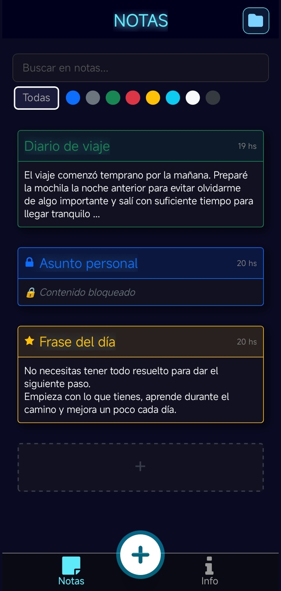
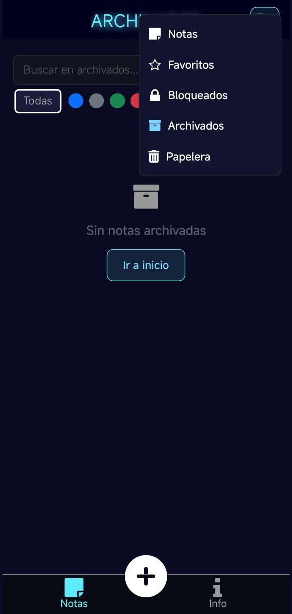
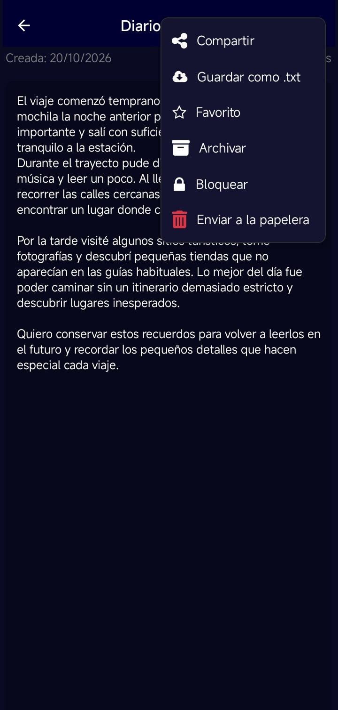
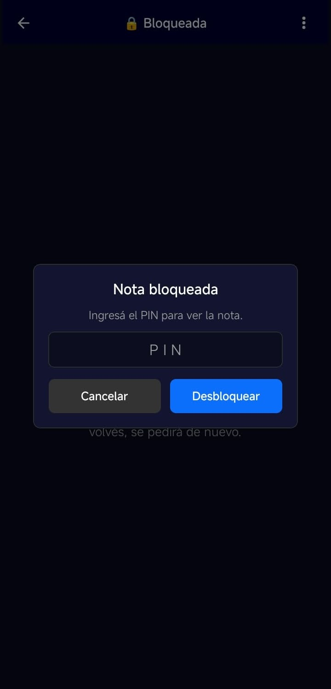

# 📌 App Notas

Aplicación de notas para **Android y web** construida con **React Native + Expo**. Permite crear, organizar y proteger notas con un almacenamiento **100 % local**: sin cuentas, sin servidores y sin conexión obligatoria.

[](https://expo.dev)
[](https://reactnative.dev)
[](https://docs.expo.dev/versions/latest/sdk/sqlite/)
[](https://developer.mozilla.org/docs/Web/JavaScript)

---

## 🖼️ Capturas

| Vista principal | Vistas y estados vacíos |
| :---: | :---: |
|  |  |
| Buscador, filtro por color, favoritos y pestañas | Menú de carpetas: Notas, Favoritos, Bloqueados, Archivados y Papelera |

| Acciones de una nota | Nota protegida con PIN |
| :---: | :---: |
|  |  |
| Compartir, guardar como `.txt`, favorito, archivar, bloquear y papelera | Desbloqueo mediante PIN con límite de intentos |

---

## ✨ Funcionalidades

### Notas
- Crear, ver y editar notas con título y contenido.
- Autocompletar el título a partir del texto si se deja vacío y validar notas vacías.
- Buscar por título o contenido y filtrar por color.
- Vista de detalle con fecha de creación y última modificación.

### Organización
- **Favoritos** para destacar notas importantes.
- **Archivados** para apartar notas sin eliminarlas.
- **Papelera** con eliminación permanente y confirmación previa.
- Vistas independientes para cada categoría desde el menú de carpetas.

### Privacidad
- **Bloqueo por nota con PIN** (mínimo 4 dígitos).
- El PIN se guarda como `salt:hash` con **SHA-256** mediante `expo-crypto`; nunca en texto plano.
- Límite de intentos fallidos con bloqueo temporal.
- Los datos permanecen en el dispositivo: **SQLite** en Android/iOS y **localStorage** en web.

### Compartir y exportar
- Compartir el contenido de la nota con las apps del sistema.
- Copiar al portapapeles en web cuando no hay API nativa de compartir.
- Guardar/exportar la nota como archivo `.txt`.

### Interfaz
- Tema oscuro, tarjetas con color por nota y navegación por pestañas (`Notas`, `Info`).
- Componentes reutilizables, modales y estados vacíos con acciones rápidas.
- Diseño adaptable: layout centrado con ancho máximo en web.
- Botón flotante en web para descargar el APK de Android.

---

## 🛠️ Tecnologías

| Área | Tecnología |
| --- | --- |
| Lenguaje | JavaScript |
| Framework | React Native 0.86 + Expo SDK 57 |
| Navegación | Expo Router (file-based routing) |
| Estado | React Context API + hooks |
| Persistencia | `expo-sqlite` (Android/iOS) · `localStorage` (web) |
| UI | `react-native-svg`, `expo-linear-gradient`, `react-native-toast-message` |
| Seguridad | `expo-crypto` (hash SHA-256 con salt) |
| Archivos | `expo-file-system`, `expo-sharing`, `expo-clipboard` |
| Calidad | ESLint (flat config) + Prettier |

---

## 📂 Estructura del proyecto

```text
app-notes/
├── app/                          # Rutas de Expo Router
│   ├── _layout.js                # Layout raíz + DataProvider + Header
│   ├── [id].js                   # Detalle / creación / edición de nota
│   ├── +not-found.js             # Vista de error 404
│   └── (tabs)/
│       ├── _layout.js            # Nav footer (Notas / Info)
│       ├── index.js              # Listado, búsqueda y filtro por color
│       └── about.js              # Información de la app
├── components/
│   ├── Card.jsx                  # Tarjeta de nota y tarjeta "nueva nota"
│   ├── SearchFilter.jsx          # Buscador y filtros por color
│   ├── Icons.jsx                 # Iconos SVG
│   ├── buttons/                  # Botones
│   ├── hooks/                    # useItems, useNoteActions
│   ├── idComponents/             # Header y editor de la nota
│   ├── layoutComponents/         # Título y menú de vistas
│   ├── modals/                   # PIN, colores y menú de opciones
│   └── utils/                    # Fechas, colores, validación, hash de PIN
├── context/dataContext.jsx       # Contexto global (notas, vista, filtro)
├── services/localNotesService.js # Persistencia local (SQLite / localStorage)
├── public/capturas/              # Capturas para el README
├── config.js                     # Flags de plataforma y URL del APK
```

---

## 🚀 Puesta en marcha

Requisitos: **Node.js**, **pnpm** y, para Android, **Android Studio** con un emulador o dispositivo físico.

```sh
# 1. Instalar dependencias
pnpm install

# 2. Iniciar el servidor de desarrollo
pnpm start

# 3. Ejecutar en una plataforma
pnpm web        # navegador
pnpm android    # build nativo de Android
pnpm ios        # build nativo de iOS (requiere macOS/Xcode)

# 4. Lint y formato
pnpm lint
```

> `pnpm start` abre Expo Dev Tools y permite elegir la plataforma de destino.

### Scripts disponibles

| Script | Descripción |
| --- | --- |
| `pnpm start` | Inicia el servidor de Expo |
| `pnpm web` | Inicia la app en el navegador |
| `pnpm android` | Compila y ejecuta en Android |
| `pnpm ios` | Compila y ejecuta en iOS |
| `pnpm lint` | Ejecuta ESLint con Prettier |

---

## 💾 Persistencia local

La app no usa backend. `services/localNotesService.js` expone una API común (`obtenerTodos`, `obtenerPorId`, `agregar`, `actualizar`, `actualizarParcial`, `eliminar`) con dos implementaciones:

- **Android/iOS:** SQLite (`expo-sqlite`, base `notasLocal.db`) con tabla `notas` y migraciones idempotentes para columnas nuevas.
- **Web:** `localStorage` bajo la clave `notasLocalStorage`.

Cada nota se normaliza y valida antes de guardarse (límites de título, texto, colores, booleanos y formato del PIN). Las fechas se almacenan en UTC y se convierten a la zona horaria local al mostrarse.

---

## 📦 Build y despliegue

### Android (EAS)

```sh
eas build -p android --profile preview   # APK de prueba
eas build -p android --profile production
```

Perfiles de build definidos en `eas.json` (`development`, `preview`, `production`).

### Web

```sh
npx expo export -p web
```

El resultado se genera en `dist/`. El archivo `.htaccess` incluido reescribe las rutas hacia `index.html` y usa `RewriteBase /app-notes/`, por lo que la app está preparada para publicarse en una subcarpeta de Apache. La propiedad `homepage` de `package.json` también apunta a `/app-notes`.

---

## 🗺️ Roadmap

- [ ] Listas de tareas.
- [ ] Recordatorios y notificaciones.
- [ ] Temas y personalización.
- [ ] Sincronización con la nube.
- [ ] Copia de seguridad y restauración.
- [ ] Widget para la pantalla de inicio (Android).

---

## 🧑‍💻 Autor

**Nicolás Pasino** — nico_pasino@hotmail.com

[](https://www.linkedin.com/in/nicolas-pasino/)
[](https://nicopasino.space)
[](https://github.com/NicoPasino)
